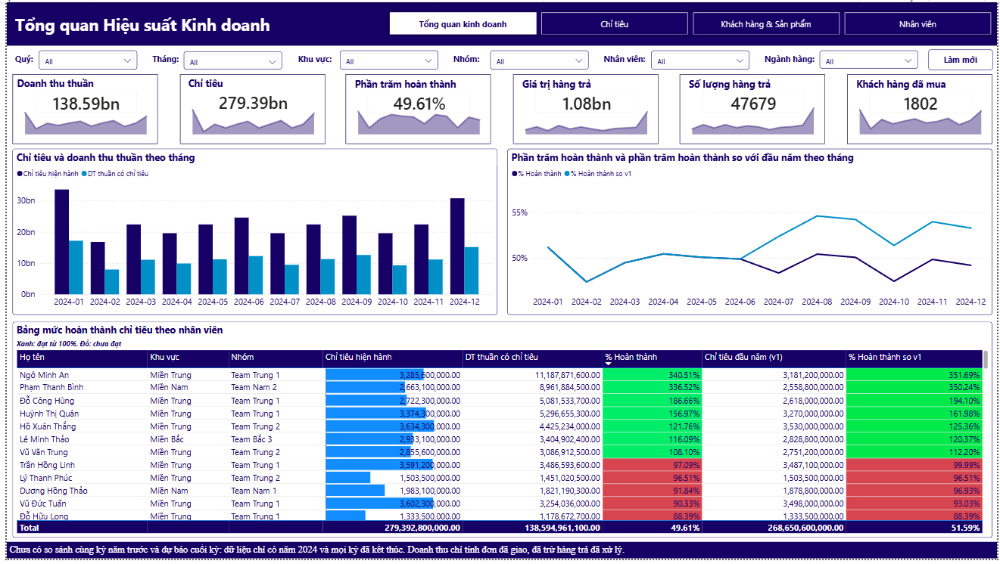
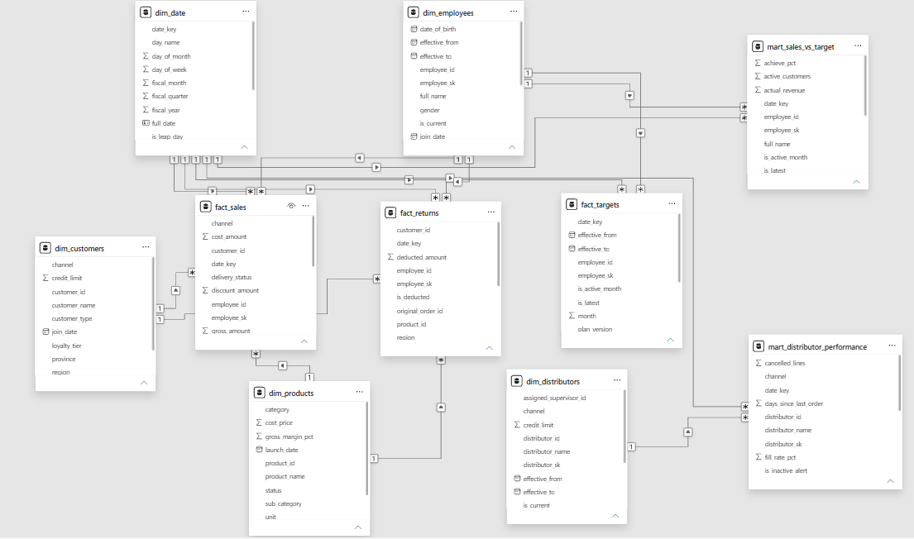
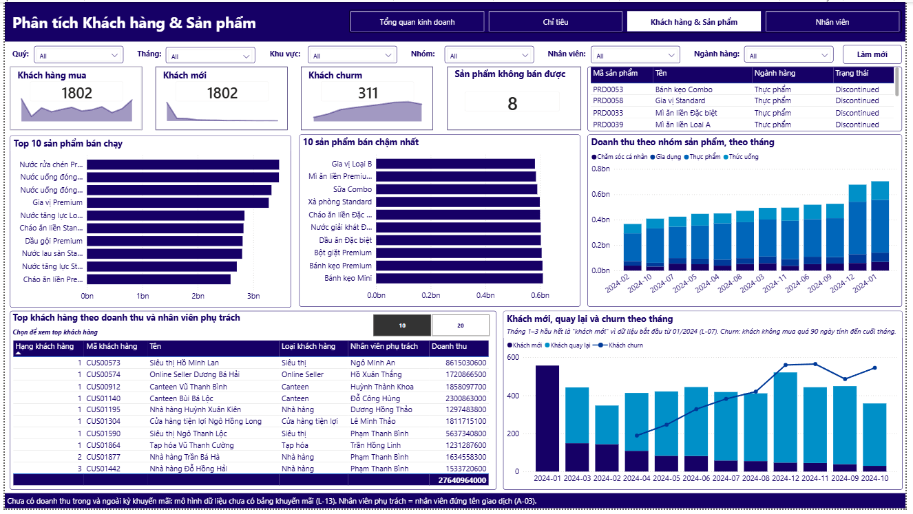
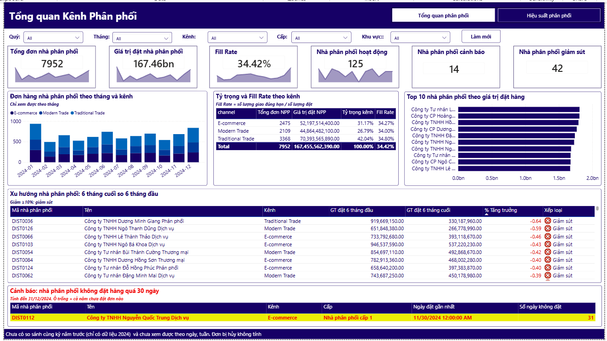

# 📊 VietDist Sales Performance & Distribution Analytics | Python, PostgreSQL & Power BI

_Theo dõi hiệu suất bán hàng so với chỉ tiêu và sức khoẻ kênh phân phối cho một công ty phân phối hàng tiêu dùng (FMCG)._

- **Business question:** Nhân viên và vùng nào đang đạt hay hụt chỉ tiêu (theo từng phiên bản kế hoạch), và nhà phân phối nào đang giảm sút hoặc ngừng đặt hàng?
- **Domain:** Phân phối hàng tiêu dùng (FMCG distribution)
- **Tools:** Python (pandas, SQLAlchemy, Google Drive API) · PostgreSQL 18 (Medallion: Bronze, Silver, Gold) · Power BI Desktop & Service (RLS, semantic model dùng chung)

---

## 📑 Table of Contents

1. [📌 Background & Overview](#-background--overview)
2. [📂 Dataset Description & Data Structure](#-dataset-description--data-structure)
3. [🧠 Design Thinking Process](#-design-thinking-process)
4. [📊 Key Insights & Visualizations](#-key-insights--visualizations)
5. [🔎 Final Conclusion & Recommendations](#-final-conclusion--recommendations)

---

## 📌 Background & Overview

### 📖 What is this project about?

Dữ liệu bán hàng của công ty nằm rải rác trong 10 file Excel/CSV trên Google Drive, nên phòng Kinh doanh và phòng Phân phối không có một nguồn số liệu thống nhất. Dự án xây một pipeline chạy trên máy cá nhân, đưa dữ liệu từ Drive vào PostgreSQL theo kiến trúc Medallion, rồi lên dashboard Power BI 6 trang.

✔️ Đo doanh thu thuần của từng nhân viên so với chỉ tiêu hiện hành **và** kế hoạch đầu năm (kế hoạch có nhiều phiên bản v1, v2).
✔️ Giữ đúng lịch sử khi nhân viên hoặc nhà phân phối chuyển vùng (SCD Type 2).
✔️ Phát hiện khách hàng churn, sản phẩm bán chậm, nhà phân phối giảm sút hoặc không đặt hàng 30 ngày.
✔️ Phân quyền xem số liệu theo vai trò bằng Row-Level Security (7 role).

### 👤 Who is this project for?

✔️ Ban Giám đốc và 3 Giám đốc Vùng: xem tiến độ chỉ tiêu toàn công ty và từng vùng
✔️ Trưởng nhóm và nhân viên Sales: theo dõi doanh số cá nhân so với chỉ tiêu
✔️ Quản lý nhà phân phối: theo dõi đơn hàng, Fill Rate, cảnh báo nhà phân phối ngừng đặt
✔️ Data analyst / data engineer muốn tham khảo một pipeline Medallion nhỏ có data quality test

---

## 📂 Dataset Description & Data Structure

### 📌 Data Source

- **Source:** 10 file nội bộ (CSV/XLSX) trên Google Drive: giao dịch bán hàng, khách hàng, sản phẩm, nhân viên, nhà phân phối, đơn hàng nhà phân phối, phiếu trả hàng, phân vùng, chương trình khuyến mãi, chỉ tiêu bán hàng
- **Size:** 119.101 dòng giao dịch bán hàng; 2.000 khách hàng; 100 sản phẩm; 138 giai đoạn nhà phân phối; 3.665 phiếu trả hàng
- **Period:** 01/01/2024 – 31/12/2024
- **Format:** .csv, .xlsx (đọc thêm .xlsm, .xlsb)

### 📊 Data Structure & Relationships

```
Google Drive (10 file CSV/XLSX)
        │  Python: Drive API, pandas, SQLAlchemy
        ▼
┌─────────────────────── PostgreSQL 18 (vietdist_dw1) ───────────────────────┐
│ raw      (Bronze)  Dữ liệu gốc, mọi cột TEXT, chỉ nối thêm, có metadata    │
│ staging  (Silver)  Ép kiểu, khử trùng, khóa chính, 92 data quality test    │
│ dwh      (Gold)    Star schema: 5 dim, 3 fact, 2 mart, 57 data quality test│
└────────────────────────────────────────────────────────────────────────────┘
        │  On-premises data gateway, refresh 7:30 hằng ngày
        ▼
Power BI Service: 1 semantic model dùng chung ── báo cáo Branch A, báo cáo Branch B
```

#### 1️⃣ Table Schema & Data Snapshot

Tầng Gold (`dwh`) có 10 đối tượng, Power BI đọc trực tiếp từ đây:

| Đối tượng | Loại | Mỗi dòng là | Khóa | Số dòng |
|---|---|---|---|---|
| `dim_date` | Dimension (bảng) | Một ngày, 2022 đến 2026 | `date_key` | 1.826 |
| `dim_employees` | Dimension, SCD Type 2 | Một giai đoạn của một nhân viên | `employee_sk` | 127 |
| `dim_customers` | Dimension, SCD Type 1 | Một khách hàng | `customer_id` | 2.000 |
| `dim_products` | Dimension, SCD Type 1 | Một sản phẩm | `product_id` | 100 |
| `dim_distributors` | Dimension, SCD Type 2 | Một giai đoạn của một nhà phân phối | `distributor_sk` | 138 |
| `fact_sales` | Fact | Một sản phẩm trong một đơn bán hàng | `order_id`, `product_id` | 119.101 |
| `fact_targets` | Fact (temporal) | Chỉ tiêu của một nhân viên, một tháng, một phiên bản | `employee_id`, `year`, `month`, `plan_version` | 1.950 |
| `fact_returns` | Fact | Một phiếu trả hàng | `return_id` | 3.665 |
| `mart_sales_vs_target` | Mart | Thực tế so chỉ tiêu của một nhân viên, một tháng, một phiên bản | `employee_id`, `year`, `month`, `plan_version` | 1.956 |
| `mart_distributor_performance` | Mart | Hiệu suất một nhà phân phối trong một tháng | `distributor_id`, `year`, `month` | 1.656 |

<details>
<summary>Bảng chính: <code>fact_sales</code> (bấm để mở)</summary>

| Cột | Kiểu | Ý nghĩa |
|---|---|---|
| `order_id`, `product_id` | text | Khóa: một sản phẩm trong một đơn |
| `date_key`, `order_date` | | Ngày đặt hàng |
| `customer_id` | text | Khách hàng |
| `employee_sk`, `employee_id` | text | Nhân viên bán, `employee_sk` theo giai đoạn tại ngày đặt |
| `region`, `province`, `channel` | text | Vùng, tỉnh, kênh của giao dịch |
| `quantity` | integer | Số lượng |
| `unit_price` | numeric | Đơn giá |
| `discount_amount`, `gross_amount`, `net_amount` | numeric | Chiết khấu, thành tiền trước và sau chiết khấu |
| `delivery_status` | text | `Delivered`, `Delivering`, `Cancelled` |
| `payment_status` | text | `Paid`, `Partial`, `Unpaid` |
| `revenue_amount` | numeric | **Doanh thu**: `net_amount` nếu `Delivered`, còn lại 0 |
| `cost_amount` | numeric | Số lượng × giá vốn hiện tại |
| `is_after_resign` | boolean | Ghi sau ngày nghỉ của nhân viên (547 dòng) |

</details>

Mô tả đầy đủ mọi bảng, cột và quy tắc dùng: [docs/data_dictionary.md](docs/data_dictionary.md).

#### 2️⃣ Data Relationships

Mọi quan hệ là nhiều-một, lọc một chiều từ dimension sang fact. Fact nối nhân viên qua `employee_sk` (đã gắn theo thời điểm giao dịch), nên báo cáo lịch sử giữ đúng vùng cũ sau khi nhân viên chuyển vùng.



---

## 🧠 Design Thinking Process

| Bước | Nội dung |
|---|---|
| 1️⃣ **Empathize** | Phòng Kinh doanh cần biết ai đạt, ai hụt chỉ tiêu; phòng Phân phối cần biết nhà phân phối nào giảm sút. Dữ liệu lại nằm ở 10 file rời, kế hoạch bị điều chỉnh giữa năm, nhân viên chuyển vùng, nên số liệu giữa các phòng không khớp. |
| 2️⃣ **Define point of view** | Cần một nguồn số liệu duy nhất, so được thực tế với **từng phiên bản** kế hoạch, giữ đúng lịch sử, và mỗi người chỉ thấy phần dữ liệu của mình. Mỗi trang dashboard ứng với một yêu cầu nghiệp vụ (BR-A-01 đến BR-B-02). |
| 3️⃣ **Ideate** | Kiến trúc Medallion trên PostgreSQL; `fact_targets` dạng temporal fact (`effective_from`, `effective_to`, `is_latest`); SCD Type 2 cho nhân viên và nhà phân phối; data quality test kiểu dbt; semantic model dùng chung và RLS 7 role. Câu hỏi nghiệp vụ còn mở được chốt bằng giả định có căn cứ (A-01 đến A-29). |
| 4️⃣ **Prototype and review** | Dựng từng tầng, chạy test sau mỗi bảng (`so_loi` = 0 là đạt), đối soát số trên dashboard với SQL trên `dwh` theo bảng [số kiểm tra](docs/dashboard_guide.md). Yêu cầu nào dữ liệu không đáp ứng được thì ghi vào Hạn chế (L-01 đến L-17). |

## ⚒️ Main Process

1️⃣ **Data Ingestion (Bronze, Python):** 10 loader đọc file từ Google Drive, giữ nguyên dữ liệu gốc dạng TEXT, thêm `_source_file`, `_source_platform`, `_ingested_at`, `_batch_id`, ghi mỗi lần nạp vào `raw.ingest_log`. Code: [`01_ingestion/`](01_ingestion/).

2️⃣ **Data Profiling & Cleaning (Silver, SQL):** khảo sát từng nguồn ([docs/data_issues.md](docs/data_issues.md)), rồi dựng 11 bảng `stg_*`: ép kiểu, khử trùng bằng `ROW_NUMBER` giữ bản nạp mới nhất, đặt khóa chính, kèm 92 test. Ví dụ vấn đề đã xử lý:

| Vấn đề | Cách xử lý |
|---|---|
| Mọi cột ở dạng chữ | Đổi sang DATE, INTEGER, NUMERIC |
| `net_amount` có dạng `908000.0` | Dùng NUMERIC thay vì INTEGER |
| 4.800 dòng `Cancelled` | Giữ ở Silver; ở Gold chỉ tính doanh thu đơn `Delivered` (A-01) |
| Kế hoạch v1 và v2 trùng tháng | Lưu cả hai phiên bản, đánh dấu `is_latest` |

3️⃣ **Modeling (Gold, SQL):** star schema 5 dim, 3 fact, 2 mart, 57 test (`not_null`, `unique`, `accepted_values`, `relationships`, đối soát giữa các tầng). Code: [`02_sql_analytics/`](02_sql_analytics/).

4️⃣ **Power BI Visualization:** 6 trang, Import mode, semantic model dùng chung trên Power BI Service, 2 báo cáo mỏng kết nối Live, RLS 7 role, refresh 7:30 hằng ngày qua on-premises gateway. DAX và cách dựng từng trang: [docs/dashboard_guide.md](docs/dashboard_guide.md).

<details>
<summary>Cài đặt và chạy lại pipeline (bấm để mở)</summary>

Yêu cầu: Python 3.11+, PostgreSQL, một Google Service Account có quyền đọc thư mục dữ liệu trên Drive.

```powershell
# 1. Môi trường Python
python -m venv venv
venv\Scripts\activate
pip install -r 00_setup\requirements.txt

# 2. Cấu hình
copy 00_setup\.env.example .env
#    Đặt file service account vào credentials\gdrive_service_account.json

# 3. Database, schema, bảng log
psql -U postgres -f 00_setup\init_db.sql
psql -U postgres -d vietdist_dw1 -f 00_setup\create_ingest_log.sql
psql -U postgres -d vietdist_dw1 -f 00_setup\create_sales_target_files.sql

# 4. Bronze: đặt FOLDER_ID trong 01_ingestion\loaders\load_base.py, rồi chạy từng loader
cd 01_ingestion\loaders
python load_sales_transactions.py
cd ..\..

# 5. Silver rồi Gold: chạy file dựng, sau đó file test (so_loi phải bằng 0)
psql -U postgres -d vietdist_dw1 -f 02_sql_analytics\silver\stg_customers.sql
psql -U postgres -d vietdist_dw1 -f 02_sql_analytics\silver\tests\test_stg_customers.sql
```

Thứ tự dựng:

- **Silver:** customers, employees, products, distributors, sales_transactions, return_transactions, territory_mapping, sales_targets, sales_targets_versioned, promotion_program, distributor_orders.
- **Gold:** dim_date, dim_employees, dim_customers, dim_products, dim_distributors, fact_sales, fact_targets, fact_returns, mart_sales_vs_target, mart_distributor_performance.

File Silver dùng `DROP TABLE ... CASCADE`, nên mỗi lần dựng lại Silver thì phải dựng lại toàn bộ Gold. File `.pbix` không có trong repo vì chứa toàn bộ dữ liệu.

```
00_setup/            requirements.txt, .env.example, script tạo database, schema, bảng log
01_ingestion/        connectors/ (Drive API), loaders/ (10 loader), utils/
02_sql_analytics/    data_profiling/, silver/ + tests/, gold/ + tests/
docs/                Từ điển dữ liệu, vấn đề dữ liệu, giả định và hạn chế, hướng dẫn dashboard
images/              Ảnh chụp dashboard
```

</details>

---

## 📊 Key Insights & Visualizations

### 🔍 Dashboard Preview

Số liệu năm 2024, khi không chọn bộ lọc.

#### 1️⃣ Tổng quan kinh doanh


📌 Analysis 1:
- **Observation:** Doanh thu 139,8 tỷ, trừ 1,08 tỷ hàng trả, còn doanh thu thuần 138,7 tỷ. So với chỉ tiêu hiện hành 279,4 tỷ, công ty mới hoàn thành **49,6%**; chỉ **7 trên 111** nhân viên đạt từ 100% cả năm. Tỷ lệ hoàn thành dao động 47–51% ở cả 12 tháng, tức chỉ tiêu xấp xỉ gấp đôi doanh thu thuần.
- **Recommendation:** Với ngưỡng đạt 100%, gần như mọi nhân viên đều hiện màu đỏ, nên đánh giá thêm bằng xếp hạng và xu hướng tương đối. Đồng thời cần rà lại cách đặt chỉ tiêu với phòng Kế hoạch, vì mức chênh đều đặn này nhiều khả năng đến từ cách tính chỉ tiêu, không phải từ pipeline.

#### 2️⃣ Chỉ tiêu theo phiên bản kế hoạch


📌 Analysis 2:
- **Observation:** Tháng 1–6 áp dụng v1, tháng 7–12 áp dụng v2. So với kế hoạch đầu năm (v1), mức hoàn thành là 51,6%; với bản điều chỉnh v2 (103 nhân viên, 140 tỷ cho nửa cuối năm) là 49,3%. Điều chỉnh giữa năm không làm tỷ lệ hoàn thành tốt lên.
- **Recommendation:** Dùng trang này để giải trình với Ban Giám đốc tháng nào chịu phiên bản nào; khi có v3 chỉ cần nạp thêm, mô hình không phải sửa.

#### 3️⃣ Khách hàng & Sản phẩm



📌 Analysis 3:
- **Observation:** 1.802 khách hàng có mua trong năm; **311 khách churn** tính đến 31/12/2024. Top 10 khách mang về 27,6 tỷ, Top 20 là 36,5 tỷ (khoảng 26% doanh thu thuần). Sản phẩm bán chạy nhất là Nước rửa chén Premium (3,47 tỷ); 8 sản phẩm không bán được, đều đã `Discontinued`.
- **Recommendation:** Giao nhân viên phụ trách chăm sóc riêng nhóm Top 20 vì rủi ro tập trung cao; lập danh sách 311 khách churn để chạy chương trình kéo lại; gỡ các mã `Discontinued` khỏi danh mục bán.

#### 4️⃣ Nhân viên


📌 Analysis 4:
- **Observation:** Theo xu hướng doanh thu, 36 nhân viên tăng trưởng tốt, 35 ổn định, 23 sa sút. Nhờ SCD Type 2, hành trình chuyển vùng được giữ đúng; ví dụ Đỗ Minh An (EMP1004) từ Miền Bắc sang Miền Trung từ 01/07 tăng doanh thu 34,7%.
- **Recommendation:** Trưởng nhóm ưu tiên kèm cặp 23 nhân viên sa sút; xem lại các trường hợp chuyển vùng thành công để áp dụng cho việc điều phối nhân sự.

#### 5️⃣ Tổng quan phân phối



📌 Analysis 5:
- **Observation:** 7.952 đơn từ nhà phân phối, giá trị đặt 167,5 tỷ. Fill Rate chỉ **34,4%**. Kênh Traditional Trade chiếm 42,0%, E-commerce 31,2%, Modern Trade 26,8%. 125 trên 138 nhà phân phối có hoạt động; **14 nhà phân phối bị cảnh báo** không đặt hàng 30 ngày (13 chưa đặt đơn nào), 42 nhà phân phối giảm sút.
- **Recommendation:** Điều tra nguyên nhân Fill Rate thấp (thiếu hàng hay quy trình giao); liên hệ ngay 14 nhà phân phối bị cảnh báo và lên kế hoạch giữ chân 42 nhà phân phối giảm sút.

#### 6️⃣ Hiệu suất phân phối


📌 Analysis 6:
- **Observation:** Giá trị đặt lũy kế đến tháng 6 là 84,0 tỷ. Biến động theo tháng lớn: tháng 2 giảm 45,0% so với tháng trước, tháng 12 tăng 21,3%.
- **Recommendation:** Theo dõi bảng nhiệt theo tháng để chuẩn bị hàng trước các tháng cao điểm và có chương trình kích cầu cho tháng thấp điểm (như sau Tết).

---

## 🔎 Final Conclusion & Recommendations

👉🏻 Dựa trên các phân tích trên, đề xuất cho **Ban Giám đốc, phòng Kinh doanh và phòng Phân phối**:

📌 Key Takeaways:
✔️ **Chỉ tiêu đang đặt quá cao so với thực tế** (hoàn thành ~50% ở mọi tháng, cả v1 và v2). Cần rà lại cách đặt chỉ tiêu; trong lúc chờ, đánh giá nhân viên bằng xếp hạng và xu hướng.
✔️ **Kênh phân phối có hai điểm nghẽn:** Fill Rate 34,4% và 14 nhà phân phối không đặt hàng 30 ngày. Đây là hai việc cần xử lý trước.
✔️ **Doanh thu tập trung ở nhóm khách lớn** (Top 20 ≈ 26%) trong khi 311 khách đã churn: cần chương trình chăm sóc khách lớn và kéo lại khách churn.

**Hạn chế:** dữ liệu chỉ có năm 2024 nên chưa so được cùng kỳ hay dự báo; không có dữ liệu tồn kho, hiệu quả khuyến mãi và chỉ tiêu nhà phân phối; RLS dùng role tĩnh; pipeline còn chạy tay. Chi tiết: [docs/assumptions_log.md](docs/assumptions_log.md).

| Tài liệu | Nội dung |
|---|---|
| [docs/data_dictionary.md](docs/data_dictionary.md) | Mọi bảng, cột, quan hệ trong Gold và quy tắc dùng trong Power BI |
| [docs/data_issues.md](docs/data_issues.md) | Kết quả khảo sát dữ liệu từng nguồn và các vấn đề phát hiện |
| [docs/assumptions_log.md](docs/assumptions_log.md) | Giả định nghiệp vụ kèm căn cứ, và các hạn chế |
| [docs/dashboard_guide.md](docs/dashboard_guide.md) | Từng trang dashboard, DAX measure, RLS, triển khai, số kiểm tra |
