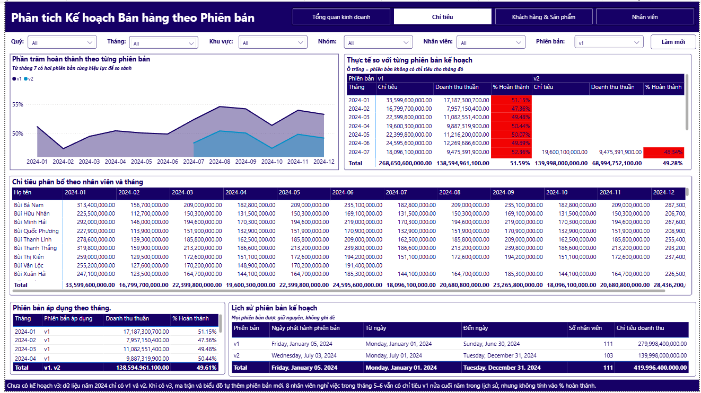
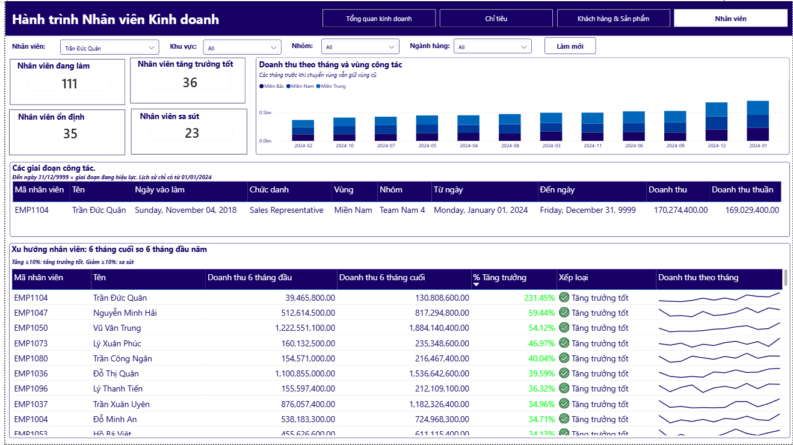
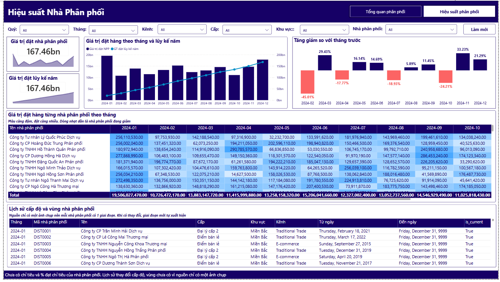

# VietDist Sales Performance & Distribution Analytics

Pipeline dữ liệu chạy trên máy cá nhân cho một công ty phân phối hàng tiêu dùng. Dữ liệu đi từ các file Excel/CSV trên Google Drive vào PostgreSQL theo kiến trúc Medallion (Bronze, Silver, Gold), rồi lên dashboard Power BI phục vụ phòng Kinh doanh và phòng Phân phối.


## Kiến trúc

```
Google Drive (10 file CSV/XLSX)
        │  Python: Drive API, pandas, SQLAlchemy
        ▼
┌─────────────────────── PostgreSQL 18 (vietdist_dw1) ───────────────────────┐
│ raw      (Bronze)  Dữ liệu gốc, mọi cột TEXT, chỉ nối thêm, có metadata    │
│ staging  (Silver)  Ép kiểu, khử trùng, khóa chính, 92 data quality test    │
│ dwh      (Gold)    Star schema: 5 dim, 3 fact, 2 mart, 57 data quality test│
└────────────────────────────────────────────────────────────────────────────┘
        │  On-premises data gateway, refresh 7:30 hằng ngày
        ▼
Power BI Service: 1 semantic model dùng chung ── báo cáo Branch A, báo cáo Branch B
```

| Tầng | Schema | Nội dung | Công cụ |
|---|---|---|---|
| Bronze | `raw` | 10 nguồn nguyên trạng, thêm `_source_file`, `_source_platform`, `_ingested_at`, `_batch_id`. Mỗi lần nạp ghi một dòng vào `raw.ingest_log` | Python |
| Silver | `staging` | 11 bảng `stg_*`: khử trùng bằng `ROW_NUMBER` giữ bản nạp mới nhất, ép kiểu, khóa chính | SQL |
| Gold | `dwh` | `dim_date` (bảng), các dim, fact, mart còn lại là view | SQL |
| Serving | Power BI | Import, semantic model dùng chung, Row-Level Security | Power BI Desktop, Service |

## Điểm kỹ thuật chính

- **Kế hoạch bán hàng nhiều phiên bản.** Kế hoạch đầu năm (v1) và bản điều chỉnh nửa cuối năm (v2) đều được giữ lại. `fact_targets` là temporal fact có `effective_from`, `effective_to`, `is_latest`. Nhờ đó so được thực tế với từng phiên bản, và khi có v3 thì không phải sửa thiết kế.
- **SCD Type 2** cho nhân viên và nhà phân phối. Fact nối với dim theo thời điểm giao dịch, nên khi nhân viên chuyển vùng thì báo cáo giai đoạn cũ vẫn giữ nguyên vùng cũ.
- **Data quality test** viết bằng SQL theo kiểu dbt: `not_null`, `unique`, `accepted_values`, `relationships`, đối soát số liệu giữa các tầng. Mỗi file test trả về `so_loi`, 0 là đạt.
- **Semantic model dùng chung** trên Power BI Service. Hai báo cáo mỏng kết nối Live vào model, nên measure chỉ cần sửa ở một nơi.
- **Row-Level Security** 7 role: Ban Giám đốc, 3 Giám đốc Vùng, Trưởng nhóm, nhân viên Sales, Quản lý nhà phân phối.
- **Giả định có ghi chép.** Mọi câu hỏi nghiệp vụ còn mở được chốt bằng giả định có căn cứ (A-01 đến A-29). Yêu cầu nào dữ liệu không đáp ứng được thì ghi vào phần Hạn chế (L-01 đến L-17).

## Dashboard

6 trang, mỗi trang ứng với một báo cáo nghiệp vụ. Số liệu năm 2024.

| Trang | Trả lời câu hỏi |
|---|---|
| Tổng quan kinh doanh | Mỗi nhân viên bán được bao nhiêu so với chỉ tiêu hiện hành và kế hoạch đầu năm |
| Chỉ tiêu | Thực tế so với từng phiên bản kế hoạch, tháng nào áp dụng phiên bản nào |
| Khách hàng & Sản phẩm | Sản phẩm bán chạy, bán chậm, Top 10/20 khách hàng, khách mới, khách quay lại, khách churn |
| Nhân viên | Hành trình công tác qua các vùng, nhóm, và xu hướng tăng trưởng của từng nhân viên |
| Tổng quan phân phối | Đơn hàng theo kênh, Fill Rate, Top nhà phân phối, cảnh báo không đặt hàng 30 ngày |
| Hiệu suất phân phối | Giá trị đặt theo tháng, lũy kế năm, xu hướng từng nhà phân phối |

| | |
|---|---|
|  |  |
|  |  |
|  |  |

File `.pbix` không có trong repo vì chứa toàn bộ dữ liệu. Cách dựng lại từng trang, toàn bộ DAX measure và số kiểm tra nằm trong [docs/dashboard_guide.md](docs/dashboard_guide.md).

## Cấu trúc thư mục

```
00_setup/            requirements.txt, .env.example, script tạo database, schema, bảng log
01_ingestion/
  connectors/        Kết nối Google Drive API
  loaders/           load_base.py và 10 loader, mỗi nguồn một file
  utils/             Đọc CSV/XLSX/XLSM/XLSB, kết nối database, thêm metadata
02_sql_analytics/
  data_profiling/    Truy vấn khảo sát dữ liệu raw
  silver/            stg_*.sql và tests/
  gold/              dim_*, fact_*, mart_*.sql và tests/
docs/                Từ điển dữ liệu, vấn đề dữ liệu, giả định và hạn chế, hướng dẫn dashboard
images/              Ảnh chụp dashboard
```

## Cài đặt và chạy

Yêu cầu: Python 3.11 trở lên, PostgreSQL, một Google Service Account được chia sẻ quyền đọc thư mục dữ liệu trên Drive.

```powershell
# 1. Môi trường Python
python -m venv venv
venv\Scripts\activate
pip install -r 00_setup\requirements.txt

# 2. Cấu hình: chép mẫu rồi điền thông tin database
copy 00_setup\.env.example .env
#    Đặt file service account vào credentials\gdrive_service_account.json

# 3. Database, schema, bảng log
psql -U postgres -f 00_setup\init_db.sql
psql -U postgres -d vietdist_dw1 -f 00_setup\create_ingest_log.sql
psql -U postgres -d vietdist_dw1 -f 00_setup\create_sales_target_files.sql

# 4. Bronze: đặt FOLDER_ID trong 01_ingestion\loaders\load_base.py là mã thư mục Drive của bạn,
#    rồi chạy từng loader trong thư mục loaders
cd 01_ingestion\loaders
python load_sales_transactions.py
cd ..\..

# 5. Silver rồi Gold: chạy file dựng, sau đó chạy file test (so_loi phải bằng 0)
psql -U postgres -d vietdist_dw1 -f 02_sql_analytics\silver\stg_customers.sql
psql -U postgres -d vietdist_dw1 -f 02_sql_analytics\silver\tests\test_stg_customers.sql
```

Phải dựng đúng thứ tự, vì có test kiểm tra quan hệ giữa các bảng:

- **Silver:** customers, employees, products, distributors, sales_transactions, return_transactions, territory_mapping, sales_targets, sales_targets_versioned, promotion_program, distributor_orders.
- **Gold:** dim_date, dim_employees, dim_customers, dim_products, dim_distributors, fact_sales, fact_targets, fact_returns, mart_sales_vs_target, mart_distributor_performance.

File Silver dùng `DROP TABLE ... CASCADE`, nên mỗi lần dựng lại Silver thì phải dựng lại toàn bộ Gold.

## Tài liệu

| File | Nội dung |
|---|---|
| [docs/data_dictionary.md](docs/data_dictionary.md) | Mọi bảng, cột, quan hệ trong Gold và quy tắc dùng trong Power BI |
| [docs/data_issues.md](docs/data_issues.md) | Kết quả khảo sát dữ liệu từng nguồn và các vấn đề phát hiện |
| [docs/assumptions_log.md](docs/assumptions_log.md) | Giả định nghiệp vụ kèm căn cứ, và các hạn chế |
| [docs/dashboard_guide.md](docs/dashboard_guide.md) | Từng trang dashboard, DAX measure, RLS, triển khai Power BI Service, số kiểm tra |

## Hạn chế chính

Dữ liệu chỉ có năm 2024 và 10 nguồn, nên các phần sau không làm hoặc chỉ làm một phần. Chi tiết xem ở [docs/assumptions_log.md](docs/assumptions_log.md).

- Không so sánh cùng kỳ năm trước và không dự báo cuối kỳ.
- Không có báo cáo tồn kho (không có nguồn dữ liệu) và báo cáo hiệu quả khuyến mãi.
- Không có chỉ tiêu nhà phân phối. Lịch sử nhân viên và nhà phân phối chỉ có từ 2024.
- RLS dùng role tĩnh, vì dữ liệu không có email người dùng.
- Pipeline chạy tay, chưa đặt lịch tự động.
